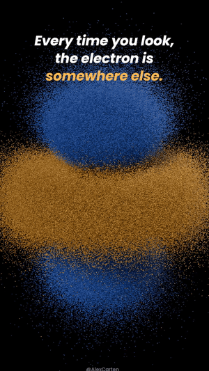
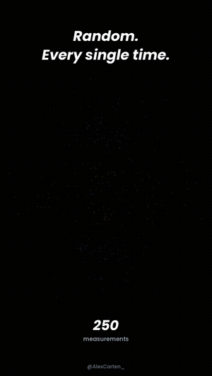
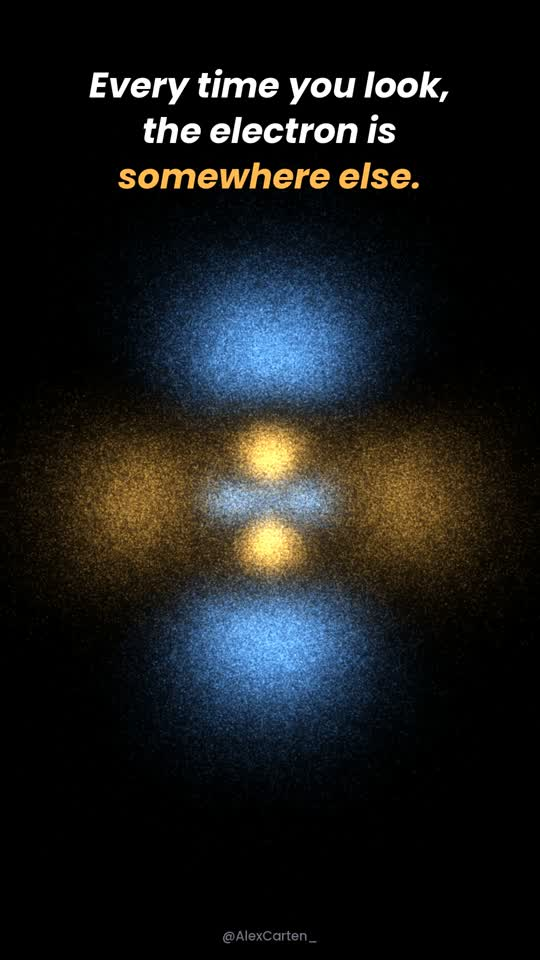
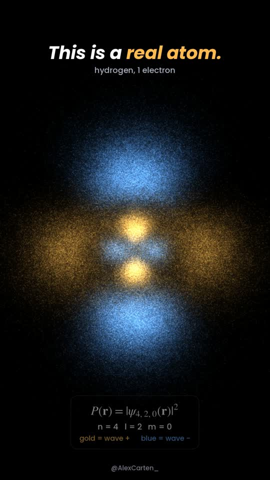

<div align="center">

# Every Dot Is a Measurement

**A hydrogen atom built from 2,000,000 places an electron was found.**

 &nbsp; 

<sub>previews: Python renderer, 130,000 points · the Blender project renders 2,000,000</sub>

*No orbit. No path. Just probability.*

[Watch on X](https://x.com/AlexCarten_) · Blender 4.2+ / 5.x · Python 3.10+

</div>

---

## What you're looking at

Your textbook drew the electron as a tiny planet circling the nucleus. It isn't.

Measure where the electron is and you get **1 random dot**. Measure again — a different dot.
There is no path between them and no way to predict the next one.

But the randomness has rules. Stack enough measurements and a shape appears:
this is the **4d state of hydrogen** (n = 4, l = 2, m = 0), and every point in the cloud is sampled
**exactly** from the Schrödinger equation — no artistic license.

| | |
|---|---|
|  |  |
| **Gold** = the wave is positive, **blue** = negative | Cut open: a shell where the electron is **never** found |

## The math

The probability of finding the electron at a point **r** is

$$P(\mathbf r) = |\psi_{4,2,0}(\mathbf r)|^2,\qquad
\psi_{4,2,0} \propto r^2\left(1-\frac{r}{12}\right)e^{-r/4}\,\left(3\cos^2\theta-1\right)$$

(r in Bohr radii). The factor $(1 - r/12)$ is zero at **r = 12** — a *radial node*:
a spherical shell inside the atom where the electron can never be found. The cut at the end of the video shows it.

Sampling is exact, not rejection-guessing:
- **radius** — inverse CDF of $r^2 R(r)^2$ on a fine grid
- **angle** — rejection sampling of $(3\cos^2\theta-1)^2$
- **φ** — uniform (m = 0 is symmetric around the axis)

## Run it

### Blender (2M particles, 3D, lit)

1. `File → New → General`
2. `Scripting → Open → blender/every_dot_blender.py → Run Script`
3. `Ctrl + F12` → video lands in `~/OrbitalRenders/every_dot/`

Everything is baked (keyframes + Geometry Nodes): no Python runs during playback or render.
Knobs at the top of the script:

| setting | default | what it does |
|---|---|---|
| `NP` | `2_000_000` | number of measurements (points) — 2 million, as in the video. 1,000,000 renders faster |
| `POINT_PX` | `2.0` | particle size on screen |
| `BRIGHT` | `1.0` | glow of the particles on top of the lighting |
| `SAMPLES` | `64` | EEVEE samples |

### Straight to MP4 (no Blender)

```bash
pip install -r requirements.txt
# put Poppins-BoldItalic.ttf and Poppins-Medium.ttf in render/fonts/ (Google Fonts, OFL)
cd render
python sample.py        # 130,000 exact samples -> pts.npy
python render.py        # -> every_dot_is_a_measurement.mp4 (1080x1920, 31 s, with sound)
python music.py         # optional: original ambient score -> every_dot_music.wav
```

## Timeline

| time | what happens |
|---|---|
| 0.0 s | the full atom, already formed |
| 2.2 s | it collapses into the nucleus |
| 2.9 s | measurements arrive 1 by 1 |
| 8–15 s | the rain of measurements — the shape comes back |
| 15.5 s | camera tilts: this is a real atom |
| 20.5 s | cut open — the radial node |
| 27 s | *No orbit. No path. Just probability.* |

## Credits

Made by **Alex Carten** — [@AlexCarten_](https://x.com/AlexCarten_).
Code: MIT. Font: Poppins (SIL OFL 1.1). Music and sound are generated by `music.py` / `render.py` — no samples.
